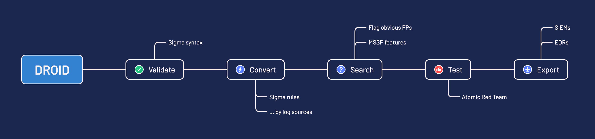

# droid

`droid` enables **Detection as Code using [Sigma](https://sigmahq.io/)**. Keep your detection rules as Sigma in a Git repository, and `droid` validates them, converts them for each of your platforms, searches your logs with them and deploys them to your SIEM and EDR, from your laptop or your CI/CD pipeline.

Built on [pySigma](https://github.com/SigmaHQ/pySigma), `droid` also handles rules written directly in a platform's query language (raw rules).



## Features

- **Validate** the syntax and the quality of your Sigma rules with the pySigma validators
- **Convert** them for each platform, with the pipelines you set per log source
- **Search** your logs with them, and report the hits before going live
- **Export** them to your platforms: create, update, disable and remove detection rules
- **Check the integrity** of what runs on a platform against your repository
- **Correlate** with Sigma correlation rules
- **Serve one log source from several telemetry sources**, each converted with its own pipelines
- **Manage several tenants** (MSSP) with per customer filters
- **Update** your rules from upstream sources such as SigmaHQ

## Supported platforms

| Platform | `--platform` | Search | Export | Integrity | Rule actions | MSSP |
| --- | --- | :---: | :---: | :---: | --- | :---: |
| Splunk | `splunk` | ✅ | ✅ | ✅ | Email, webhook | |
| Microsoft Sentinel | `microsoft_sentinel` | ✅ | ✅ | ✅ | | ✅ |
| Microsoft Defender XDR | `microsoft_xdr` | ✅ | ✅ | ✅ | Response actions on users, files and devices | ✅ |
| Elastic Security (ES\|QL) | `esql` | ✅ | ✅ | ✅ | Index, server log, email, webhook | |
| Elastic Security (EQL) | `eql` | ✅ | ✅ | ✅ | Index, server log, email, webhook | |

Each platform needs its pySigma backend, see [Getting started](#getting-started). The [documentation](https://certeu.github.io/droid-docs/platforms/) details what each platform supports.

## Getting started

### 1. Install droid and your backends

Python 3.11.8 or later is required.

```sh
python3 -m venv .venv && . .venv/bin/activate
pip install detect-droid
```

Then install the [pySigma backend](https://sigmahq.io/docs/digging-deeper/backends.html) of each platform you target:

| Platform | Backend |
| --- | --- |
| Splunk | `pip install pysigma-backend-splunk` |
| Microsoft Sentinel and Defender XDR | `pip install pysigma-backend-kusto` |
| Elastic Security | `pip install pysigma-backend-elasticsearch` |

### 2. Lay out your rules

```
detection-rules/
├── droid_config.toml
├── sigma-rules/          # your Sigma rules
├── raw-rules/            # optional, rules in a platform query language
└── pipelines/            # your pySigma processing pipelines
```

To start from a ready-made layout, clone [droid-init](https://github.com/certeu/droid-init).

### 3. Configure droid

`droid_config.toml` tells droid where your rules are and how to reach each platform. Each log source gets the pipelines that map it to your data:

```toml
[base]
sigma_rules_directory = "sigma-rules"
raw_rules_directory = "raw-rules"

[platforms.splunk]
url = "splunk.example.org"
port = "8089"
# ...

[platforms.splunk.pipelines.windows_process_creation]
pipelines = ["splunk_windows", "pipelines/splunk_process_creation.yml"]
product = "windows"
category = "process_creation"
```

Credentials come from environment variables, e.g. `DROID_SPLUNK_USER` and `DROID_SPLUNK_PASSWORD`, never from the configuration file. See [Configuration](https://certeu.github.io/droid-docs/configuration/) and the page of your [platform](https://certeu.github.io/droid-docs/platforms/).

### 4. Run it

```sh
# Check your rules
droid rules validate -r sigma-rules/ -c droid_config.toml

# See the query each rule becomes
droid rules convert -r sigma-rules/ -p splunk -c droid_config.toml

# Search your logs with them, before deploying
droid rules search -r sigma-rules/ -p splunk -c droid_config.toml

# Deploy them
droid rules export -r sigma-rules/ -p splunk -c droid_config.toml

# Check that the platform still runs what the repository holds
droid rules integrity -r sigma-rules/ -p splunk -c droid_config.toml
```

Add `--debug` for details, or `--json` for a JSON log, handy in CI/CD. `droid --help` lists every command and option.

### 5. Automate it

Run these commands in your CI/CD pipeline: validate and search on every merge request, export and check the integrity once merged. Your detection rules then follow the same review, history and rollback as code.

## Documentation

The full documentation lives at [certeu.github.io/droid-docs](https://certeu.github.io/droid-docs/).

## Resources

- [Sigma Unleashed: A Realistic Implementation](https://www.first.org/resources/papers/conf2024/1315-1350-Sigma-Unleashed-Mathieu-Le-Cleach.pdf), FIRST 2024

## Contributing

See [CONTRIBUTE.md](./CONTRIBUTE.md), including how to add a platform.

## License

Licensed under the [EUPL](./LICENSE).
